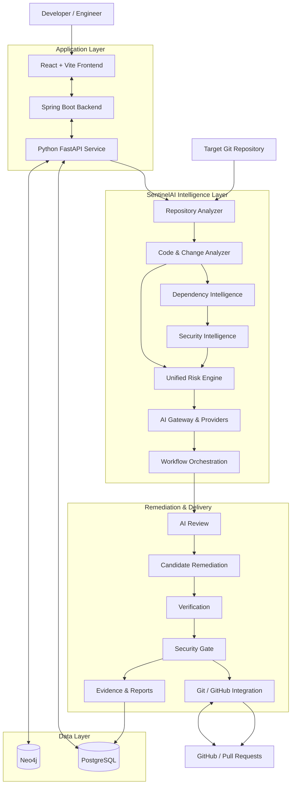
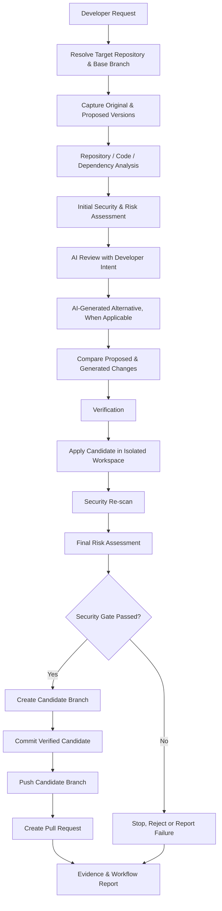
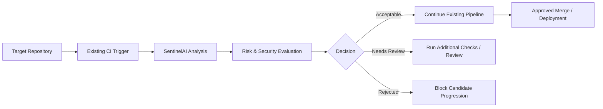

# 🛡️ SentinelAI

### An AI-Native DevSecOps Intelligence & Intelligent CI/CD Platform

**Analyze. Understand. Predict. Secure. Remediate. Verify. Deliver.**

SentinelAI is an AI-powered DevSecOps platform designed to bring contextual intelligence to the software delivery lifecycle. Instead of treating every code change as an identical pipeline execution, SentinelAI aims to understand repository structure, analyze code changes, correlate dependencies and security findings, assess risk, and support safer software remediation through an intelligent CI/CD workflow.

It combines a **Java Spring Boot backend, Python-based AI services, a React frontend, repository intelligence, security analysis, risk assessment, and Git/GitHub integration** into a modular platform.

> **The core idea:** A pipeline should not simply ask, “Did the build pass?” It should also ask, “What changed, what could break, what security risks exist, and is this change safe to proceed?”

---

## ⚡ The Vision

Traditional CI/CD systems primarily automate predefined steps.

SentinelAI introduces an intelligence layer that can evaluate a change before deciding what should happen next.

```text
TRADITIONAL CI/CD

Code Change
    │
    ▼
Build → Test → Scan → Deploy
    │
    ▼
Fixed Workflow
```

```text
SENTINELAI — INTELLIGENT CI/CD

Code Change
    │
    ▼
Repository Intelligence
    │
    ▼
Change & Dependency Analysis
    │
    ▼
Security Intelligence
    │
    ▼
Risk Assessment
    │
    ▼
AI Review & Decision Support
    │
    ▼
Verification & Security Gates
    │
    ▼
Controlled CI/CD Action
    │
    ▼
Evidence, Reports & Audit Trail
```

The long-term objective is to make software delivery **context-aware, risk-driven, explainable, and progressively more efficient**.

---

## ✨ Core Capabilities

| Capability | Purpose |
|---|---|
| 🔍 Repository Intelligence | Understand repository structure, languages, files, and Git history. |
| 🧩 Code & Change Analysis | Identify changes and evaluate potentially affected components. |
| 🔗 Dependency Intelligence | Extract dependency information and represent component relationships. |
| 🔐 DevSecOps Analysis | Integrate security findings from tools such as Gitleaks, Trivy, Semgrep, and OWASP Dependency-Check. |
| 🧠 AI-Assisted Review | Supply repository context, change details, and developer intent to AI analysis. |
| 📊 Unified Risk Assessment | Combine available security and change-related evidence into a risk assessment. |
| 🛠️ Remediation Workflow | Evaluate proposed local changes and AI-generated alternatives. |
| ✅ Verification & Security Gates | Reassess a candidate change before allowing subsequent Git operations. |
| 🌿 Candidate-Branch Workflow | Isolate proposed changes from the repository's base branch. |
| 🔄 GitHub Integration | Support repository-oriented workflows, candidate pushes, and pull-request integration. |
| 📦 Evidence & Reporting | Organize analysis results, risk information, and workflow evidence. |
| 🖥️ Multi-Service Architecture | Separate the application backend, AI service, frontend, and data infrastructure. |

**Implementation status:** The project contains a working multi-service foundation and implemented analysis/workflow components. Individual integrations and end-to-end behavior must still be validated against the current code and runtime configuration.

---

## 🏗️ System Architecture

SentinelAI is organized around distinct application, intelligence, security, integration, and infrastructure layers.



### 1. Frontend — React + Vite

The frontend provides the interface through which engineers can interact with SentinelAI and inspect available analysis results.

Responsibilities include:

- Communicating with backend APIs.
- Presenting repository and analysis information.
- Displaying workflow status and security findings.
- Providing a foundation for risk and remediation visibility.

### 2. Backend — Java Spring Boot

The backend provides the application-facing service layer.

Responsibilities include:

- Application initialization and configuration.
- API and service integration.
- Request handling and exception management.
- Communication between the user interface and supporting services.

### 3. AI Service — Python + FastAPI

The Python service contains the repository intelligence and AI-oriented processing components.

Responsibilities include:

- Repository, code, and change analysis.
- Dependency extraction and graph processing.
- Security analysis and risk evaluation.
- AI gateway and provider integration.
- Workflow orchestration and remediation components.

### 4. Data Layer — PostgreSQL + Neo4j

- **PostgreSQL:** Relational storage for supported application and workflow data.
- **Neo4j:** Graph-oriented storage for repository, dependency, or component relationships where configured.

The precise persistence behavior depends on the configured service implementations and database schemas.

---

## 🧠 The Intelligence Layer

SentinelAI is designed to evaluate software changes using multiple sources of evidence rather than relying on a single scanner or an isolated AI response.

### Repository intelligence

The repository analysis layer establishes context about the target codebase.

It is designed to inspect:

- Repository structure and metadata.
- Programming languages and project files.
- Git history and change information.
- Code organization and imports.
- Relevant files and components affected by a proposed change.

### Dependency intelligence

The dependency layer helps establish relationships between application components and external libraries.

```text
Repository
    │
    ├── Application Module
    │       │
    │       └── Library A
    │               │
    │               └── Library B
    │
    └── Application Module B
            │
            └── Shared Component
```

The objective is to make it possible to connect a change or vulnerability to the components that may be affected.

### Security intelligence

Security analysis is designed to bring findings from multiple sources into a common evaluation process.

| Tool | Intended role |
|---|---|
| Gitleaks | Secret and credential exposure detection |
| Trivy | Vulnerability and configuration scanning |
| Semgrep | Static analysis and security rules |
| OWASP Dependency-Check | Dependency vulnerability analysis |
| SonarQube | Code quality and supported security analysis |

Tool availability, configuration, scan execution, and result normalization depend on the installed tools and environment.

### Unified risk assessment

The risk engine is intended to combine available evidence, such as:

- Security findings.
- Change scope and affected components.
- Dependency relationships.
- Verification results.
- Other supported repository and workflow signals.

The resulting assessment is intended to inform the next workflow action.

**Important:** A risk score is only as reliable as the evidence and scoring logic behind it. It should not be interpreted as a calibrated probability of failure unless that capability has been explicitly implemented and validated.

---

## 🔄 The Advanced CI/CD Workflow

The central workflow being developed in SentinelAI is an AI-assisted, security-gated remediation pipeline that accepts a target repository dynamically.

A developer supplies the target GitHub repository, the base branch, the target file or change, the local proposed version when applicable, and the reason for the modification.

SentinelAI then evaluates the proposed change through a controlled workflow.



### Workflow stages

**1. Request and repository resolution**

- Accept the target repository dynamically.
- Identify the intended base branch and target.
- Capture the developer's reason for the proposed modification.

**2. Establish a baseline**

- Retrieve or inspect the original repository version.
- Compare the original version with the proposed local version.
- Collect available repository, dependency, and change context.

**3. Initial security and risk assessment**

- Run the configured analysis components.
- Collect available findings.
- Calculate an initial risk assessment from supported evidence.

**4. AI review and remediation**

- Supply the developer's intent and relevant code context to the AI workflow.
- Evaluate the proposed modification.
- Generate or evaluate an alternative where supported.
- Compare the local proposal with the AI-generated candidate.

**5. Verification**

- Evaluate the candidate change.
- Apply it in an isolated candidate workspace.
- Run the configured verification and security checks.
- Recalculate risk and compare the available before-and-after evidence.

**6. Security gate**

The workflow is intended to prevent an unsuccessful or rejected candidate from advancing to a push operation.

A failed verification or security gate should stop the candidate from being published.

**7. Git and GitHub operations**

When the required checks pass and integration permissions are available, the workflow can proceed through the candidate-branch process:

- Create a candidate branch.
- Commit the verified change.
- Push the candidate branch.
- Request pull-request creation.
- Preserve relevant workflow evidence.

**8. Evidence and reporting**

The intended outcome is a traceable record of the request, the proposed change, the analysis, the verification results, and the resulting Git operation.

> **Safety principle:** The target repository's base branch should not be modified directly by the remediation workflow. Candidate changes should be reviewed and merged through the repository's normal approval process.

---

## 🔒 Security-First Design

Security is not intended to be a final step added after code generation. It is part of the decision process.

SentinelAI's remediation design follows these principles:

- **Baseline comparison:** Evaluate a proposed change against the original version.
- **Context-aware review:** Include developer intent and relevant repository information.
- **Candidate isolation:** Apply proposed modifications in a controlled workspace.
- **Verification before publication:** Do not publish candidates that fail required checks.
- **Risk reassessment:** Compare available evidence before and after remediation.
- **Branch protection:** Keep the base branch separate from automated candidate changes.
- **Credential separation:** Use environment configuration or approved secret-management mechanisms instead of committing credentials.
- **Traceability:** Preserve supported evidence of the workflow and its decisions.

AI-generated changes are proposals, not proof of correctness. They must be checked by deterministic tests, security controls, and appropriate human review.

---

## 🧰 Technology Stack

| Layer | Technologies |
|---|---|
| Frontend | React, Vite, TypeScript where configured |
| Application backend | Java, Spring Boot, Maven |
| AI and orchestration | Python, FastAPI |
| Relational database | PostgreSQL |
| Graph database | Neo4j |
| Version control | Git, GitHub |
| CI/CD integration | GitHub Actions and repository-oriented workflows |
| Security analysis | Gitleaks, Trivy, Semgrep, OWASP Dependency-Check, SonarQube |
| Containers | Docker, Docker Compose |
| API communication | HTTP / REST |
| AI integration | Configured AI gateway and supported providers |

Some tools represent the intended integration ecosystem rather than guaranteed active dependencies in every deployment. Consult the configuration and dependency files before assuming a specific tool is installed or enabled.

---

## 📁 Project Structure

The following is a **high-level architectural map** of the repository. It is not intended to replace the actual file tree; individual modules and optional integrations may differ by implementation state.

```text
SentinelAI/
│
├── .github/
│   └── workflows/
│       └── sentinelai-security.yml
│
├── .sentinelai/
│   └── reports/
│
├── ai/
│   ├── api/
│   ├── analyzer/
│   │   ├── repository/
│   │   ├── code/
│   │   └── change/
│   ├── ai_gateway/
│   │   └── providers/
│   ├── dependency/
│   ├── integrations/
│   │   ├── github/
│   │   ├── remediation/
│   │   └── security/
│   ├── intelligence/
│   │   └── risk/
│   ├── orchestration/
│   ├── phase7/
│   ├── pipeline/
│   ├── security/
│   └── tests/
│
├── backend/
│   ├── pom.xml
│   └── src/
│       └── main/
│           ├── java/
│           │   └── com/
│           │       └── sentinelai/
│           │           └── backend/
│           └── resources/
│
├── database/
│   ├── postgres/
│   └── neo4j/
│
├── docker/
│
├── frontend/
│   ├── src/
│   ├── public/
│   └── package.json
│
├── scripts/
│
├── docker-compose.yml
├── .gitignore
├── README.md
└── LICENSE
```

### Module responsibilities

| Directory | Responsibility |
|---|---|
| `ai/api/` | Python API entry point and service endpoints |
| `ai/analyzer/` | Repository, code, and change analysis |
| `ai/ai_gateway/` | AI provider abstraction and integration |
| `ai/dependency/` | Dependency extraction and graph processing |
| `ai/integrations/` | External integrations, including GitHub and remediation-related components |
| `ai/intelligence/risk/` | Risk evaluation and supporting intelligence |
| `ai/orchestration/` | Coordination of analysis and workflow stages |
| `ai/pipeline/` | Pipeline-related processing |
| `ai/security/` | Security analysis components |
| `backend/` | Spring Boot application |
| `database/` | Database schemas, configuration, and related assets |
| `docker/` | Container-related configuration |
| `frontend/` | User interface |
| `.github/workflows/` | GitHub Actions workflow definitions |
| `.sentinelai/reports/` | Local SentinelAI report area, subject to configured output and ignore rules |

---

## 🚀 Getting Started

### Prerequisites

Install the tools required for the components you intend to run:

- Git
- Python and the version supported by the AI service
- Java Development Kit compatible with the Spring Boot project
- Maven, if not using the project's wrapper
- Node.js and npm
- Docker Desktop with Docker Compose, if using the containerized setup
- PostgreSQL and Neo4j, or their configured containers

### 1. Clone the repository

```bash
git clone https://github.com/Jayz-yuors/SentinelAI.git
cd SentinelAI
```

### 2. Configure environment variables

Inspect the supplied environment templates and configuration files. Create local environment files from the templates that exist in the repository.

Never copy real API keys, passwords, personal access tokens, or other secrets into the repository.

### 3. Start the configured services

If the Docker Compose configuration is complete for your environment:

```bash
docker compose config
docker compose up --build -d
docker compose ps
```

Check service health and logs before using the APIs:

```bash
docker compose logs --tail=100
```

### 4. Validate the services

The Python API has been exercised through the pipeline analysis endpoint:

```text
POST /pipeline/analyze
```

An example request body used during testing was:

```json
{
  "repositoryUrl": "https://github.com/octocat/Hello-World.git",
  "branch": "master"
}
```

Example PowerShell request:

```powershell
$body = @{
    repositoryUrl = "https://github.com/octocat/Hello-World.git"
    branch = "master"
} | ConvertTo-Json

$result = Invoke-RestMethod `
    -Uri "http://localhost:8000/pipeline/analyze" `
    -Method POST `
    -ContentType "application/json" `
    -Body $body

$result | ConvertTo-Json -Depth 30
```

The request shape and port reflect the previously exercised local API setup. Confirm the current API routes, service ports, and required request fields in the checked-out implementation before relying on them.

### 5. Explore the remediation workflow

Use the project's current CLI help and configured integration settings to discover the available commands.

Before enabling any push operation, verify:

- The intended target repository and base branch.
- The identity and permissions of the configured GitHub credential.
- The candidate-branch behavior.
- The verification and security-gate conditions.
- The absence of secrets in the working tree and Git history.

Do not use a production repository as the first test target.

---

## ⚙️ CI/CD Integration Strategy

SentinelAI is designed to complement existing CI/CD systems rather than require every target project to adopt a new build system.

The platform's repository-oriented approach is intended to support workflows initiated against different repositories, with repository URLs and branch information supplied at runtime.



### Intended integration behavior

1. Receive a repository or change-analysis request.
2. Inspect the available repository context.
3. Evaluate change impact and security evidence.
4. Produce an analysis and risk assessment.
5. Decide whether the change can proceed, needs review, or should be blocked.
6. Run the configured verification steps.
7. Publish an eligible candidate through Git/GitHub integration.
8. Retain supported evidence for later inspection.

GitHub Actions can serve as a trigger or enforcement point. Other CI systems can be integrated through their own APIs, webhooks, or command-line entry points as those integrations are implemented.

**SentinelAI does not automatically replace the target repository's existing tests, branch protection, approval requirements, or deployment controls.**

---

## 🧪 Testing & Validation

The project includes a testing area and analysis components, but the presence of test files alone does not establish complete coverage.

Validation should be performed at multiple levels:

| Test level | What to validate |
|---|---|
| Unit tests | Individual analyzers, risk logic, and service functions |
| API tests | Request validation, responses, and error handling |
| Integration tests | Communication between backend, AI service, and databases |
| Repository tests | Repository access, branch selection, and diff handling |
| Security tests | Scanner execution, result parsing, and gate behavior |
| Remediation tests | Candidate generation, verification, and failure handling |
| GitHub tests | Branch creation, push permissions, and pull-request permissions |
| End-to-end tests | Complete workflow from request to final result |

### Critical acceptance criteria

- An invalid repository request fails safely.
- A missing or inaccessible branch is reported clearly.
- A failed verification cannot progress to a push.
- A rejected security gate prevents publication of the candidate.
- The base branch is not modified directly by remediation.
- Missing GitHub permissions produce an actionable error.
- Secrets are not written into logs, reports, commits, or repository history.
- A successful API response is not mistaken for proof that every workflow stage succeeded.

---

## 📊 Implementation Status

SentinelAI is an evolving engineering project. The status below separates established foundations from capabilities that still require full validation.

| Area | Status |
|---|---|
| Git and project foundation | Established |
| Spring Boot backend foundation | Established |
| Backend common infrastructure | Established |
| Python FastAPI service | Implemented foundation; validate current routes |
| Repository, code, and change analysis | Implemented components; validate coverage |
| Dependency and security intelligence | Implemented components; validate integrations |
| Risk assessment | Implemented components; validate scoring and evidence |
| AI gateway and orchestration | Present in the project architecture; validate providers and paths |
| Local remediation workflow | Developed and exercised; full end-to-end behavior needs further validation |
| Candidate-branch and GitHub integration | Implemented workflow components; permissions and end-to-end behavior require validation |
| Automated verification and security gate | Intended workflow controls; test every failure path |
| Pull-request creation | Integration attempted; a previous attempt returned HTTP 403 due to GitHub token permissions |
| React frontend | Project component present; validate complete feature coverage |
| PostgreSQL and Neo4j | Configured infrastructure; validate each required data path |
| Production deployment and monitoring | Requires separate verification before being described as production-ready |
| Complete end-to-end release workflow | Still requires comprehensive validation |

### Current engineering priority

The next major objective is not simply adding more modules. It is proving that the **complete remediation path behaves safely and consistently**, including negative test cases, GitHub permissions, security gates, evidence generation, and successful pull-request creation.

---

## 🗺️ Roadmap

### Phase 1 — Repository Intelligence

- Improve repository and code understanding.
- Strengthen change and impact analysis.
- Expand dependency relationships.

### Phase 2 — Security & Risk Intelligence

- Normalize scanner output.
- Correlate findings with affected components.
- Validate risk calculations and reporting.

### Phase 3 — Intelligent CI/CD

- Refine the AI decision and remediation workflow.
- Validate verification and security-gate behavior.
- Improve candidate-branch and pull-request automation.
- Establish repeatable end-to-end acceptance tests.

### Phase 4 — Infrastructure & Observability

- Harden service configuration and database integrations.
- Validate container health and recovery.
- Expand operational logging, metrics, and deployment readiness.

### Phase 5 — Frontend, Learning & Validation

- Complete dashboard functionality.
- Improve decision and evidence visibility.
- Validate the full workflow with representative repositories.
- Evaluate historical pipeline data before claiming predictive or continuous-learning capabilities.

---

## 🔐 Configuration & Credential Safety

SentinelAI interacts with Git repositories, external services, and potentially sensitive security findings. Credential hygiene is essential.

- Keep `.env` files and local credentials out of version control.
- Use environment templates containing placeholders only.
- Never commit GitHub personal access tokens or private keys.
- Use narrowly scoped credentials with only the permissions required.
- Review Git history before publishing the repository.
- Rotate any credential that has been exposed; deleting a file alone does not invalidate the credential.
- Treat AI-generated code and security findings as untrusted inputs until validated.
- Restrict automated write access and retain human approval for sensitive changes.

---

## 🎯 Why SentinelAI?

Most conventional pipelines focus on executing steps. SentinelAI explores a different approach: use repository context, security evidence, risk evaluation, and AI-assisted reasoning to make the delivery workflow more selective and explainable.

Its intended value comes from bringing these capabilities together:

- **Context over blind execution**
- **Risk assessment over identical treatment of every change**
- **Security gates over trust in generated code**
- **Candidate branches over direct automated modification**
- **Evidence over opaque decisions**
- **Validation over unverified claims of autonomy**

The goal is not to remove engineering judgment. It is to provide engineers with better information and safer automation.

---

## 🤝 Contributing

Contributions should preserve the platform's modular design and security-first principles.

1. Create a feature branch.
2. Make a focused change.
3. Add or update tests for the affected behavior.
4. Validate relevant security and integration checks.
5. Document configuration or API changes.
6. Submit a pull request for review.

Never include credentials, private keys, or real production secrets in issues, commits, test fixtures, or pull requests.

---

## 📄 License

See the [`LICENSE`](LICENSE) file for the terms applicable to this project.

---

<div align="center">

### 🛡️ SentinelAI

**Making software delivery more intelligent, contextual, and secure.**

*Analyze → Reason → Verify → Deliver*

</div>
